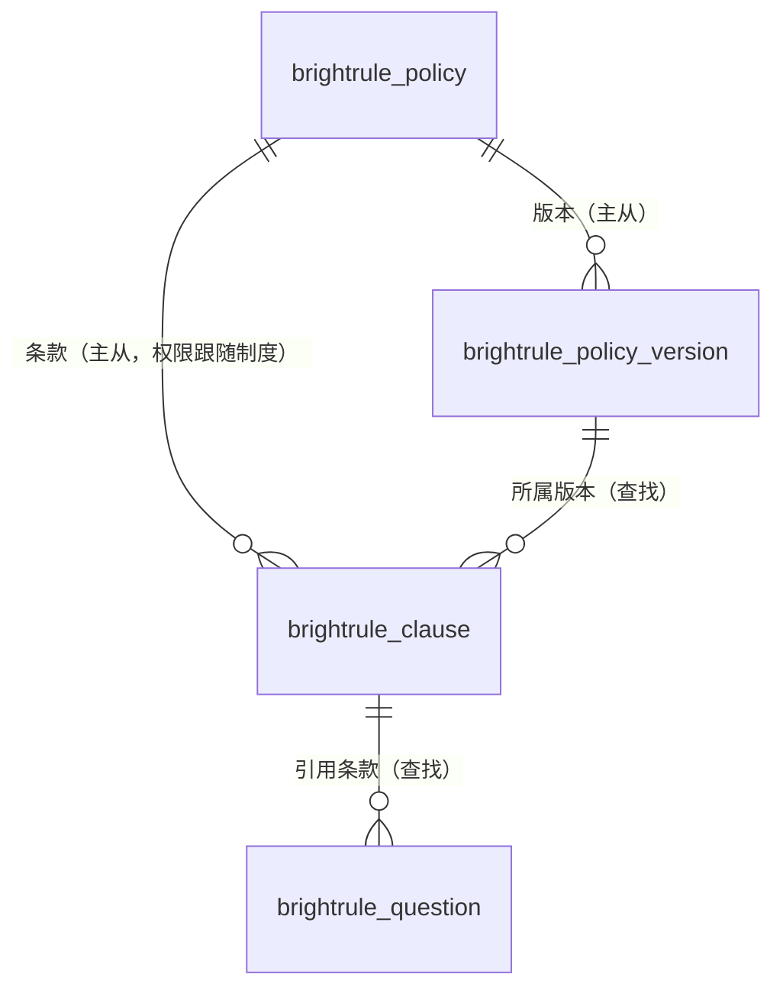
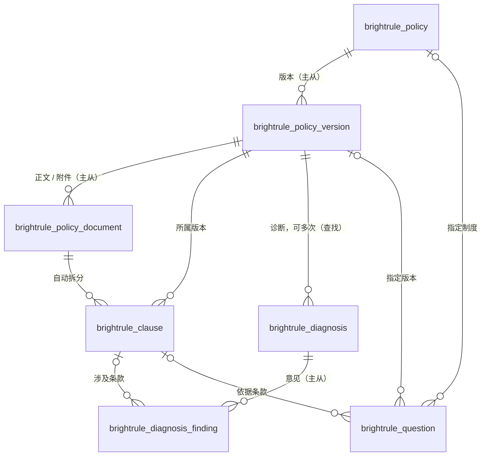

# 制度管理应用审查与调整清单（2026-11-24 会议）

> 状态：**待确认。**AI 诊断的设计需要田老师参与讨论，整体调整范围需要应用负责人确认，见第 5 节。
> 本文对照 11-24 会议意见审查本分支现有应用，给出三样东西：功能清单（第 2 节）、数据关系（第 3 节）、关键页面与演示路线（第 4 节）。
> [`solution.md`](solution.md) 中与本文冲突的规划（立项计划、会签、审批签发、宣贯签收等），以本文为准，暂不实施。

## 1 会议意见

| 编号 | 意见 |
|---|---|
| M1 | **定位是制度管理门户**，用户从本系统进入。要做完整的制度管理，问询只是进入制度之后的一项功能 |
| M2 | **两类用户**：问制度的人，只能问询；编撰和审核制度的人（制度管理员），能看诊断、参与讨论 |
| M3 | **先管集团这一层**，按单公司做好；多公司以后照此复制 |
| M4 | **AI 诊断**：对制度版本做诊断，可以诊断多次，每次出一批意见。AI 的意见相当于 AI 发表的一条评论，人可以回复、@ 相关人讨论，讨论完打勾完成。制度的迭代讨论在讨论区完成，正式修订仍走正式发文。诊断意见只给有权限的人看，不给普通员工看。**具体怎么设计，由田老师和 AI 一起讨论** |
| M5 | **问询只查定稿版本**，不考虑追溯历史；搞不清该用哪个版本，由人来判断。有三种问法：① 通用问，由 AI 找出相关制度来回答；② 选中某份制度问；③ 选中某个版本问。回答要说明依据的是哪几份制度、哪个版本 |
| M6 | **条款降为拆分手段**：条款挂在版本下面，版本一改，条款全部重新生成；自动拆分，不靠人工逐条维护。按大条还是按小条拆是细节，影响的是检索效果 |
| M7 | **检索**：大模型先从问题里抽关键词，再做模糊匹配或向量匹配，结果再交给大模型。向量模型还要选型；通过第三方接口建向量，数据要发给对方 |
| M8 | **不用本地模型，靠脱敏把数据安全地发出去**：库里存脱敏后的制度，发给 AI 的始终是脱敏版，展示给用户的是原文。替换词用编码对照，可以还原 |
| M9 | **存储**：每份制度由正文、若干附件和元数据组成，都转成 Markdown；先放在项目文件夹里就行 |
| M10 | **不做年度计划、立项这类重流程**，修订流程也先不管 |
| M11 | 评测（关联事项，不在本项内）：脱敏后，每份制度由 Fable 出几十道题，所有模型用不同深度作答，Fable 打分并出图。先挑常用制度走通 |
| M12 | 平台的多模型配置（简单问题用便宜模型）由平台侧负责，本项只负责制度管理应用本身 |

## 2 功能清单

| 功能 | 现状 | 调整 | 依据 |
|---|---|---|---|
| 制度库（门户首页） | 有「制度库」列表，排在「制度问询」之后 | 作为应用首页和第一个导航项；按分类筛选；列表显示定稿版本号和生效日期 | M1 |
| 制度详情 | 平台默认详情页 | 在一页里集中展示：基本信息、版本列表、定稿版本的正文和附件、「问这份制度」入口；管理员另外能看到诊断记录 | M1、M2、M5 |
| 版本管理 | 版本有草稿 / 现行 / 已失效三种状态；某版本转为现行时，旧版本自动失效，条款跟着切换 | 保留。「现行」即会议上说的「定稿」（标签是否改名，见第 5 节） | M5 |
| 版本文档（正文 + 附件） | 没有 | 新增：每个版本挂一份正文和若干附件，各存原文 Markdown 和脱敏 Markdown | M8、M9 |
| 条款 | 人工逐条维护；挂在制度下（主从）并指向版本（查找）；导航里有「条款」「现行条款」两个入口 | 改为从版本文档自动拆出的检索片段，版本定稿时生成或重新生成。拆分结果可以查看，不再作为维护入口 | M6 |
| 问询 | 只有通用问：从全部现行条款里检索，再由大模型判断能否作答 | 新增「指定制度」「指定版本」两种范围；答复列出依据的制度、版本和条款；送给 AI 的是脱敏文本，展示时还原原文 | M5、M7、M8 |
| 转人工 | 答不上就转「待人工答复」 | 保留 | — |
| AI 诊断 | 没有 | 新增：对某个版本发起诊断，可多次，每次产出一批意见。只有管理员可见 | M4 |
| 诊断意见的讨论 | 没有 | 每条意见带讨论区（平台记录自带评论和 @ 提及），有处理状态和负责人，处理完打勾 | M4 |
| 脱敏 | 本地工具 `tools/redact`：产出脱敏 docx 和 md、原件 md、对照表 | 应用导入脱敏结果：检索和发给 AI 只用脱敏文本；替换词对照表入库（仅管理员可读），用来还原 AI 答复 | M8、M9 |
| 导入 | 只有种子数据 | 新增导入脚本：读取 `tools/redact` 的输出目录（正文、附件、原件 md），写入制度、版本、版本文档，并自动拆分条款 | M9 |
| 权限 | 没有权限集，所有登录用户权限相同 | 新增两类：「制度问询人」（只读制度库里的定稿版本，只能问询）和「制度管理员」（明细见第 3 节「两类用户各能看到什么」） | M2、M4 |
| 多公司隔离 | 没有 | 不做 | M3 |
| 示例对象 Notes | 在导航里 | 删除 | — |
| 立项计划、会签、审批签发、宣贯签收、复审 | 只在 `solution.md` 里规划，没有实现 | 暂不做 | M10 |

## 3 数据关系

### 现状

### 调整后

| 对象 | 变化 | 主要字段 |
|---|---|---|
| 制度 `brightrule_policy` | 保留；补充真实制度暴露出的字段 | 现有字段，加上制度层级、发文文号、审议 / 决议主体、协同部门 |
| 制度版本 `brightrule_policy_version` | 保留 | 版本号、状态（草稿 / 现行 / 已失效）、修订说明、生效日期 |
| 版本文档 `brightrule_policy_document` | **新增**；主从挂版本，一份正文加若干附件，各一条记录 | 类型（正文 / 附件）、序号、标题、原件 docx（正式文本，附件可下载填写）、脱敏 docx、原文 Markdown（页面展示）、脱敏 Markdown（拆条、检索、送 AI 的唯一来源）、脱敏批次、复查是否通过 |
| 条款 `brightrule_clause` | **改为自动生成**：归属版本，并记录来自哪份文档；所属制度由版本自动带出（已实现），条款权限仍跟随制度 | 章、条号、引用出处、原文正文（展示）、脱敏正文（检索、送 AI）、是否现行、拆分序号。原文和脱敏版按同一结构拆，两边条数不一致时导入报错 |
| 诊断 `brightrule_diagnosis` | **新增** | 所属版本、诊断时间、模型、诊断维度、状态、摘要、意见数 |
| 诊断意见 `brightrule_diagnosis_finding` | **新增**；开启记录讨论区（评论、@ 提及） | 类别、严重程度、涉及条款、原文摘录、意见、建议改法、处理状态（待处理 / 讨论中 / 采纳 / 不采纳 / 已完成）、负责人、处理说明 |
| 脱敏对照 `brightrule_redaction_term` | **新增**，只有管理员可读；由导入从脱敏工具的词典写入 | 类别、原文、替换值、是否还原用的标准名（一个替换值对应全称、简称等多个原文时，还原成标准名） |
| 问询 `brightrule_question` | 增加问询范围和依据；改为提问人只看自己的（现在是所有人可读可改） | 问询范围（通用 / 指定制度 / 指定版本）、指定制度、指定版本、依据（制度 + 版本列表）；其余字段保留 |

### 两类用户各能看到什么

| 数据 | 制度问询人 | 制度管理员 |
|---|---|---|
| 制度 | 有定稿版本、未废止的制度，只读 | 全部，包括草稿和已废止的；可新建、编辑 |
| 制度版本 | 只有定稿（现行）版本 | 全部：草稿、现行、已失效；可新建版本、设为现行 |
| 版本文档（正文 / 附件） | 定稿版本的原文 | 全部版本的原文和脱敏版 |
| 条款 | 定稿版本的条款，只在答复的依据里出现 | 全部版本拆出的条款 |
| 诊断、诊断意见 | 看不到 | 全部；可发起诊断、在讨论区回复、改处理状态 |
| 脱敏对照 | 看不到 | 只读（由导入写入） |
| 问询记录 | 只看自己提的 | 全部人的问询，包括待人工答复；可人工答复 |

这里的「全部」是指集团这一层（M3）。将来如果要按归口部门分工（例如人事部只管人事类制度），再把制度管理员拆成「体系管理员」和「归口部门编撰人」。

**诊断不能挂成版本的主从子表。**主从子表的权限跟随父记录，员工能读版本，就能读到诊断。所以诊断用查找关系挂版本，对象本身设为私有，只授权给制度管理员（M4）。

## 4 关键页面与演示路线

| # | 页面 | 演示内容 | 谁能看 |
|---|---|---|---|
| 1 | 制度库（首页） | 按分类浏览，看到每份制度的定稿版本号和生效日期 | 全部 |
| 2 | 制度详情 | 基本信息、版本列表、定稿版本的正文和附件；点「问这份制度」 | 全部；诊断区仅管理员 |
| 3 | 版本详情 | 正文和附件（原文）、自动拆出的条款；点「问这个版本」 | 全部（问询人只能看到定稿版本） |
| 4 | 诊断 | 对某个版本发起诊断，看本次的意见列表，按状态和类别筛选 | 管理员 |
| 5 | 诊断意见详情 | AI 意见和建议改法；在讨论区 @ 相关人，对方回复后打勾完成 | 管理员 |
| 6 | 我要问询 | 分别演示通用问、指定制度、指定版本三种问法；答复里写明依据的制度、版本和条款，可以展开看原文 | 全部 |
| 7 | 待人工答复 | 答不上的问题，由管理员答复 | 管理员 |

演示顺序：用制度问询人登录，走 1 → 2 → 6（三种问法各一题，再加一道无依据的题，看它转人工）；再换制度管理员登录，走 4 → 5 → 7。

## 5 需要确认的事

**请田老师参与讨论（诊断设计，M4）**

1. AI 意见的承载方式。
   - 推荐方案：每条意见是一条记录，自带讨论区。这样能按状态、负责人筛选和统计。
   - 另一种方案：AI 直接在版本上发评论。这最接近会上的设想，但统计和跟踪靠平台评论功能，平台的评论「打勾完成」还在开发中。
2. 诊断查什么。候选维度：表述歧义、可执行性（缺流程、缺时限、缺责任人）、条款缺失、内部矛盾、与其他现行制度冲突、引用了已废止的制度、合规性。哪些先做，各自的意见模板是什么。
3. 什么时候诊断：手动发起，还是版本导入后自动跑一次；同一个版本多次诊断时，要不要和上一次对比。
4. 意见的处理状态和闭环：哪些状态算处理完，「采纳」之后要不要关联到新版本。

**请应用负责人确认**

5. 「现行」是否改称「定稿」。
6. 「指定版本」问询是否对普通员工开放。按 M5，员工只能看到已发布的版本；建议员工只能问定稿版本，历史版本只给管理员问。
7. 原文 Markdown 是否入库。部署在客户内网可以入库；如果是云端部署，入库的只能是脱敏版，原文留在本地。
8. 条款拆分粒度。建议按「条」拆，过长的条再按「款」切。
9. 向量模型选型（M7）：脱敏后用国内云端的中文向量模型，候选 bge-m3、通义 text-embedding-v3 等，需要用真实题集比一下。

## 6 实施顺序

| 步 | 内容 | 依赖 |
|---|---|---|
| 1 | 两类权限；制度库首页和制度详情；版本文档；条款自动拆分；问询三种范围；导入 `tools/redact` 的输出；删除 Notes | 第 5 节第 5–8 项（可以先按建议做） |
| 2 | 送 AI 一律用脱敏文本；用对照表还原后展示原文 | 第 7 项 |
| 3 | AI 诊断和意见讨论 | 第 1–4 项（田老师） |
| 4 | 搭演示环境，按第 4 节的路线准备演示数据和脚本 | 前三步 |

M11 的评测循环（出题、多模型作答、打分出图）复用 `scripts/eval` 的题集格式。应用侧只保证每道题都能指定制度、版本作答，并记下依据，便于打分。
