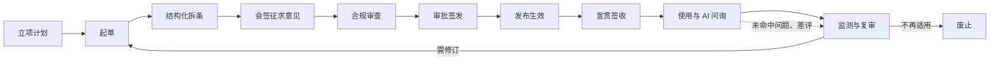
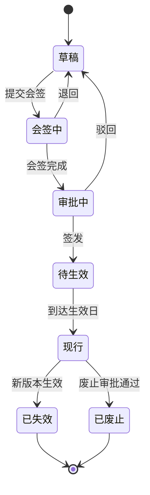
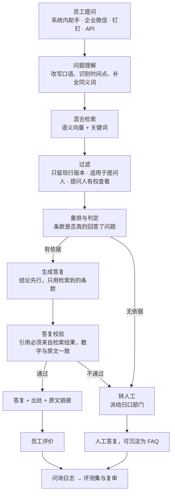
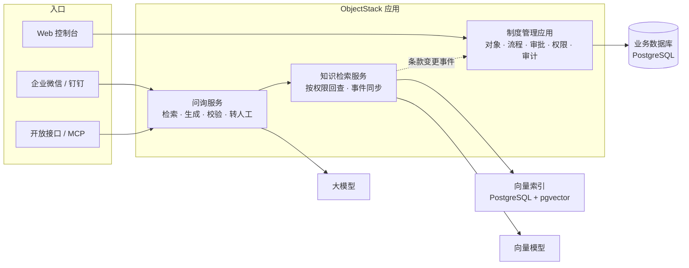

# 制度全生命周期管理与 AI 制度问询 — 解决方案

> 状态：**方案草案 v0.3（2026-11-23），待评审。** 向量索引定为 PostgreSQL + pgvector，不采用 RAGFlow。
>
> **与 [`product-brief.md`](product-brief.md) 的关系。** 简报 §3.2 的问答默认路线是「目录导航 + 全文阅读」，向量检索作为语义召回不足时的补充。本方案改为**以 pgvector 语义检索为主**：先检索、再以提问人权限回查、只引用现行条款。两条路线的取舍（准确率、响应时间、成本）建议用同一组真实问题实测后定，见 §09。
>
> 本分支已落地的代码：`src/objects/`（制度 / 版本 / 条款 / 问询）、`src/qa/`（检索与答复、版本联动、向量检索适配器）、`src/data/seed.ts`（示例数据）。

从立项、起草、会签、审批、发布，到宣贯、使用、问询、复审、废止，一套数据、一条主线。AI 问询只依据现行有效的条款作答，每个答复都注明出处，找不到依据就转人工。方案基于 ObjectStack 平台，关键链路已在本地原型中跑通。

## 01 总览

制度管理和 AI 问询共用一个事实来源：**拆分到条的制度条款库**。管理侧负责让条款库始终等于“现行有效的制度”，问询侧只从条款库里取证据作答。两侧不各存一份，所以不会出现“制度改了、AI 还在按旧规定回答”。

- **只答现行**：草稿、待生效、已失效、已废止的条款不进入答复范围。新版本生效的同时，旧版本条款自动退出。
- **句句有出处**：每个答复都标明《制度名》版本号和第几条，可以点开看原文。没有出处的话不说。
- **看不到的问不到**：检索后按提问人自己的权限回查，机密制度、不适用于本人的制度不会被引用。

## 02 角色与职责

| 角色                 | 主要职责                           | 在系统中的动作                                                 |
|----------------------|------------------------------------|----------------------------------------------------------------|
| 制度管理员（体系办） | 制度体系规划、编号规则、发布与归档 | 维护分类与模板、发起年度计划、执行发布、查看全局看板           |
| 归口部门 / 起草人    | 起草、修订、解释本部门制度         | 起草版本、上传原件、校对拆条结果、回复会签意见、答复转人工问询 |
| 会签部门             | 就涉及本部门的条款提意见           | 逐条提出意见、确认会签                                         |
| 法务 / 合规          | 合法合规性审查、冲突审查           | 审查意见、查看 AI 冲突检测结果、审批通过或退回                 |
| 审批人 / 签发人      | 按制度层级审批签发                 | 审批、签发、电子签章                                           |
| 员工                 | 学习和遵守制度                     | 浏览制度库、阅读签收、AI 问询、评价答复                        |
| 审计 / 内控          | 监督制度执行                       | 只读查看版本历史、审批记录、签收记录、问答日志                 |
| 系统管理员           | 平台、模型与集成运维               | 配置权限、模型接口、企业微信/钉钉入口，查看评测报告            |

## 03 制度生命周期

每个阶段都有明确的产出和控制点。控制点是系统强制的，不靠人记。

| 阶段         | 做什么                                 | 系统能力                                                                            | 控制点                                           |
|--------------|----------------------------------------|-------------------------------------------------------------------------------------|--------------------------------------------------|
| 立项计划     | 年度制定、修订、废止计划；临时立项     | 立项单、计划看板、按归口部门分派                                                    | 无立项不能起草公司级制度                         |
| 起草         | 按模板起草，上传原件，标注上位依据     | 制度模板、编号规则自动生成、原件附件、关联上位制度                                  | 编号唯一；必填归口部门、适用范围、密级           |
| 结构化拆条   | 把正文拆成“章 / 条 / 款”，每条一个记录 | AI 辅助拆条：自动识别章条结构，生成标题、关键词、同义词建议；人工逐条校对           | 全部条款经人工确认后才能提交会签                 |
| 会签征求意见 | 相关部门并行会签                       | 会签审批（全部同意 / 多数同意可配），意见挂在具体条款上，起草人逐条回复             | 未回复的意见不能进入下一步                       |
| 合规审查     | 合法合规、与现行制度一致性             | AI 冲突检测：同一事项在不同制度中口径不一致、重复规定、引用已废止制度               | 冲突项必须处理或说明理由                         |
| 审批签发     | 按层级审批：公司级、部门级             | 多级审批流，按制度层级和金额类条款自动路由；审批中版本锁定；生成带签章的 PDF 发布件 | 审批中不可修改；驳回退回起草                     |
| 发布生效     | 编号发布，到生效日自动生效             | 状态“已批准待生效”到生效日自动转“现行”；同一制度的旧版本自动失效                    | 同一制度同一时刻只有一个现行版本；已发布版本只读 |
| 宣贯签收     | 推送给适用人员阅读确认                 | 按适用范围（组织、岗位）自动生成签收任务，催办，可选随堂测验                        | 签收率看板，逾期未签自动提醒                     |
| 使用与问询   | 查阅制度、提问                         | 制度库（分类、部门、适用对象筛选）、AI 问询、FAQ                                    | 问询只用现行且有权限的条款                       |
| 监测与复审   | 定期复审，发现问题修订                 | 复审到期提醒；问询热点、未命中问题、差评答复汇总给归口部门                          | 超期未复审在看板标红                             |
| 废止         | 制度不再适用                           | 废止审批，联动全部版本失效，条款退出问询范围，被引用处提示                          | 废止需审批，保留全部历史可查                     |

**为什么坚持“拆到条”。**条款是天然的语义单元，也是员工引用制度的方式（“按差旅办法第五条”）。拆到条之后，问询可以精确引用到条，会签意见可以挂到条，版本对比可以比到条，冲突检测可以按条比较。用 AI 辅助拆条，人工只做校对，工作量可控。

## 04 版本与生效规则

- **一个现行。**同一制度同一时刻只有一个“现行”版本。新版本转现行时，旧版本自动转“已失效”，旧条款同步退出问询范围。
- **发布即冻结。**“待生效”之后的版本和条款只读。任何改动都必须新建修订版本，重新走审批。
- **定时生效。**签发时填写生效日期，到期由系统自动切换，不依赖人工在当天操作。
- **可追溯。**保留全部历史版本、审批记录、签收记录；支持任意两个版本逐条对比。
- **按时间点查询。**问询默认按现行制度回答；问题里带有时间（如“去年 3 月出差的标准”）时，按当时生效的版本回答，并明确标注“该版本已失效”。

## 05 数据模型

| 对象       | 关键内容                                                         | 说明                         |
|------------|------------------------------------------------------------------|------------------------------|
| 制度       | 编号、名称、分类、层级、归口部门、密级、状态、现行版本、复审日期 | 一份制度一条记录             |
| 制度版本   | 版本号、状态、生效 / 失效日期、修订说明、原件、签章发布件        | 状态见第 04 节               |
| 制度条款   | 章、条、款编号，标题，正文，关键词，引用出处，是否现行，向量     | 问询的最小引用单元           |
| 适用范围   | 制度 × 组织 / 岗位 / 人员类别                                    | 决定签收推送和问询可见性     |
| 制度关联   | 替代、依据、引用、冲突                                           | 废止和修订时提示受影响制度   |
| 会签意见   | 条款、意见、回复、是否采纳                                       | 意见挂在条款上               |
| 阅读签收   | 人员、版本、状态、确认时间、测验成绩                             | 签收率统计                   |
| 问询记录   | 问题、答复、引用条款、匹配度、答复来源、是否转人工、评价         | 全量留痕，是评测与改进的原料 |
| 同义词词典 | 标准词与员工常用说法（网约车 ↔ 滴滴、打车）                      | 提升检索命中，归口部门可维护 |
| 评测题集   | 问题、标准答案条款、类别                                         | 每次换模型、调参数都回归一遍 |

## 06 AI 问询方案

### 处理链路

### 答复规范

员工问：下周去上海出差，酒店一晚 650 元能全额报销吗？

不能全额报销。上海属于一线城市，住宿标准为每晚不超过 600 元，超出的 50 元由个人承担。

《差旅费报销管理办法》V3.0 第五条

- **结论先行**，再给依据。能用“能 / 不能 / 多少”回答的，先回答。
- **必须引用**到《制度名》版本和条，多条相关时并列列出。
- **不编造。**答复里的每个数字、每个条件都必须能在被引条款里找到，系统逐项校验。
- **不越界。**涉及个人具体情况（如本人年假余额）、法律意见、制度未规定的事项，说明边界并给出归口部门。
- **冲突时说明。**两条现行条款口径不一致时，并列给出并提示“已反馈归口部门确认”，同时生成一条冲突待办。

### 条款向量化

| 环节       | 做法                                                                                               |
|------------|----------------------------------------------------------------------------------------------------|
| 切块       | 一条条款就是一个块，不再按字数切分                                                                 |
| 向量化内容 | “《制度名》第 N 条 标题 + 正文 + 关键词 + 同义词”，带上制度名，避免被其他制度里的同类词带偏        |
| 向量模型   | 中文向量模型，兼容 OpenAI 接口即可：通义 text-embedding-v3、智谱 embedding-3、bge-m3（可内网部署） |
| 存储       | 生产环境 PostgreSQL + pgvector；开发环境内存                                                       |
| 增量更新   | 条款新增、修改、转现行、失效时只更新这一条                                                         |
| 打分       | 语义相似度为主，关键词匹配为辅；编号、金额、专有名词靠关键词兜底                                   |
| 换模型     | 记录生成向量的模型；模型变更时全量重建，并用评测集回归                                             |

### 转人工与知识沉淀

- 无依据、校验不通过、员工差评的问询，自动派给归口部门，并设答复时限。
- 人工答复必须引用条款或说明“制度未规定”。可勾选“沉淀为 FAQ”，FAQ 参与后续检索，但答复时仍以条款为出处。
- “制度未规定”的高频问题，汇总为制度修订建议，进入复审。

## 07 技术实现

### 存储：三层，只有一层是事实来源

| 层     | 存什么                       | 存在哪                                                    | 能否重建                   |
|--------|------------------------------|-----------------------------------------------------------|----------------------------|
| 原件层 | Word / PDF 原件、签章发布件  | 文件存储（附件）                                          | 不可重建，长期归档         |
| 结构层 | 制度、版本、条款             | 业务数据库                                                | 不可重建，**唯一事实来源** |
| 索引层 | 每条条款一条检索文档及其向量 | PostgreSQL + pgvector（开发环境可用内存，由环境变量选择） | 随时可从结构层重建         |

索引里的每条记录用“知识源 id + 条款 id”标识，与条款一一对应，并记录生成向量的模型和正文哈希。索引损坏、丢失或更换模型时，从条款表全量重建，不需要人工维护第二份数据。

### 更新：一个动作，系统完成连锁

已发布版本只读，修订就新建版本。管理员只做一件事：把新版本设为“现行”。

1.  新版本的条款逐条标为现行。
2.  同一制度原来的现行版本转为“已失效”，它的条款逐条标为非现行。
3.  制度主档的现行版本号同步更新。
4.  每条条款的改动产生一个记录变更事件，知识检索服务据此更新这一条的索引。

- **逐条写入，不用批量更新：**批量更新只产生“改了 N 行”的计数事件，索引无法据此同步。
- **只改状态不重算向量：**按正文哈希判断，正文没变的条款只更新元数据，不调用向量模型。
- **兜底：**启动时全量重建；生产环境增加每日对账。

### 向量化

1.  每条条款拼成一段文本：“《制度名》版本 第 N 条 + 标题 + 正文 + 关键词 + 常见说法”。带上制度名，避免“报销”之类的通用词把问题带到别的制度。
2.  调用向量模型（兼容 OpenAI 接口：通义、智谱、bge-m3 等）得到向量，归一化后保存，同时记录模型名和正文哈希。
3.  提问时用同一个模型对问题向量化；部分模型要求给问题加固定前缀（如 BGE 系列），通过配置项提供。
4.  保留关键词索引与向量检索一起使用，编号、金额、专有名词靠关键词兜底。

索引存放位置和向量模型都通过环境变量配置，同一套程序在开发环境用内存、生产环境用 pgvector：

| 环境变量                              | 作用                                                                       |
|---------------------------------------|----------------------------------------------------------------------------|
| `OS_KNOWLEDGE_VECTOR_STORE`           | `memory`（默认，启动时从条款表重建）或 `pgvector`（持久化，HNSW 余弦索引） |
| `OS_KNOWLEDGE_PGVECTOR_URL`           | Postgres 连接串，选 pgvector 时必填                                        |
| `OS_KNOWLEDGE_PGVECTOR_TABLE`         | 向量表名，默认 `os_knowledge_vectors`；换维度不同的模型时指向新表          |
| `OS_KNOWLEDGE_EMBEDDING_BASE_URL`     | 向量模型接口地址                                                           |
| `OS_KNOWLEDGE_EMBEDDING_MODEL`        | 模型名，如 `BAAI/bge-m3`、`text-embedding-v3`；配置后问询改用语义检索      |
| `OS_KNOWLEDGE_EMBEDDING_API_KEY`      | 接口密钥                                                                   |
| `OS_KNOWLEDGE_EMBEDDING_DIMENSIONS`   | 向量维度（模型不在内置清单时填写）                                         |
| `OS_KNOWLEDGE_EMBEDDING_QUERY_PREFIX` | 问题前缀（非对称模型需要）                                                 |

配置不可用时启动即报错并指出要改的变量，例如选了 pgvector 却没给连接串、表的向量维度与模型不一致。

### 一次问询的完整处理过程

以“下周去上海出差，酒店一晚 650 能全额报销吗？”为例：

| 步  | 做什么                                                                   | 本例结果                                                     |
|-----|--------------------------------------------------------------------------|--------------------------------------------------------------|
| 0   | 从登录会话确认提问人身份和权限                                           | B 公司财务部员工                                             |
| 1   | 保存问询记录，触发答复处理                                               | 新建一条问询                                                 |
| 2   | 理解问题：改写为检索句，识别时间点，抽取实体，同义词扩展                 | “一线城市出差住宿报销标准”；时间点：现行；实体：上海、650 元 |
| 3   | 混合检索：在本公司和集团范围内，向量与关键词各取前 20 条后合并打分       | 差旅第五条排第一                                             |
| 4   | 过滤：只留现行版本、适用于提问人的条款，并以提问人身份回查，查不到的丢弃 | 旧版 V2.0 第五条被滤掉                                       |
| 5   | 判定：条款是否真的回答了问题；低于阈值转人工                             | 判为相关                                                     |
| 6   | 生成答复：大模型只看前 3–5 条条款和固定规则，输出结论和引用              | 不能全额报销，超出 50 元自理                                 |
| 7   | 校验：引用必须来自第 4 步结果，数字必须能在原文找到；不通过转人工        | 600、50 均可核对                                             |
| 8   | 保存答复、引用、匹配度、模型版本和检索到的条款，供审计                   | 写入问询记录                                                 |
| 9   | 展示答复、出处、原文链接；员工评价，差评转人工并进入评测集               | —                                                            |

## 08 集团多公司隔离

集团下有多家平级公司时，问询要同时满足两件事，处理方式不同：

|      | 要求                                 | 性质               | 做法           |
|------|--------------------------------------|--------------------|----------------|
| 隔离 | 员工看不到、也引用不到平级公司的制度 | 安全要求，硬性保证 | 记录级权限     |
| 优先 | 本公司和集团制度都相关时，本公司在前 | 业务规则           | 检索范围与排序 |

### 组织建模

集团、各公司建成业务单元的上下级树，放在同一个组织内。不建成相互隔离的多个组织：那样集团发布的制度要在每家公司各复制一份。

### 隔离：靠权限，不靠模型自觉

- 制度增加“发文单位”：集团、A 公司、B 公司。可见性默认收紧，再用共享规则放开：集团发文全集团可读；公司发文只给本公司及下级单元。条款、版本随制度权限。
- 问询检索出的条款以提问人身份回查，查不到的丢弃。B 公司员工的答复里不可能出现 A 公司的条款。

### 优先本公司：检索前就限定范围

- 条款索引带上发文单位，检索只在“本公司 + 集团”范围内进行，平级公司的条款不参与检索。
- 不能只靠检索后过滤：全集团范围取前 10 条，A 公司条款可能占满，过滤后 B 公司员工一条不剩，被误判为“找不到”。所以先限定范围，再按权限回查兜底。
- 本公司与集团条款都相关时，本公司条款为主依据，集团条款作为补充依据并列给出。

B 公司员工问：出差住宿每晚能报多少？

根据《B 公司差旅费实施细则》V1.0 第三条：……（本公司规定）  
集团《差旅费报销管理办法》V3.0 第五条另有规定：……

**需客户确认：**同一事项上公司细则与集团办法冲突时以谁为准，公司细则比集团宽松是否有效。这条规则决定答复写法，需要客户明确。

## 09 准确率与验收

准确率不靠承诺，靠测。上线前用客户自己的真实问题建评测集，至少 200 题，覆盖每个制度分类，包含同义说法、带数字的问题、跨制度问题，以及约 10% 与制度无关的问题。

| 指标           | 定义                                   | 上线门槛（建议） |
|----------------|----------------------------------------|------------------|
| 错答率         | 引用了错误条款，或答复内容与条款不符   | ≤ 2%             |
| 答对率         | 结论正确且引用正确                     | ≥ 85%，持续提升  |
| 转人工率       | 有依据但系统判定无依据而转人工         | ≤ 10%            |
| 无关问题拒答率 | 与制度无关的问题正确拒答               | ≥ 98%            |
| 引用可核对率   | 答复中的数字、条件均能在被引条款中找到 | 100%             |

**当前基线（本地原型实测）。**仅用关键词检索、不接向量模型和大模型时，30 道换说法的问题中答对 21 题（70%），转人工 6 题（20%），错答 3 题（10%）；5 道无关问题全部正确拒答。失败几乎都是同义词问题，例如“滴滴”对不上“网约车”。这说明向量检索和答复校验是上线前必须补齐的两项。

上线后持续监控：差评率、转人工率、未命中问题热点。每次更换模型、调整阈值、批量修订制度后，用评测集回归一次，指标不退化才能发布。

## 10 安全与合规

- **权限一致。**问询沿用制度本身的权限（密级、适用范围、共享规则）。检索结果按提问人身份回查后才能引用，原型中已实现。
- **数据不出域。**向量模型和大模型均可选私有化部署（如 bge-m3、Qwen、DeepSeek 系列），制度内容不出企业网络。
- **全量留痕。**每次问询记录问题、检索到的条款、答复、模型版本，可供审计复核。
- **防注入。**大模型只接收检索到的条款文本和固定的答复规则，条款内容不会被当作指令执行；答复经校验后才展示。
- **个人信息。**问询日志按企业规定设置保留期；统计分析默认去标识化。
- **免责边界。**答复页固定提示“以正式发布的制度文本为准”，并提供原文链接。

## 11 部署架构

**已定：生产环境向量索引采用 PostgreSQL + pgvector，不采用 RAGFlow。**理由：条款已经结构化拆分，不需要 RAGFlow 的文档解析；pgvector 复用 PostgreSQL，不增加一整套独立服务的运维；向量持久化，重启不需要重新向量化。

| 环境           | 向量索引                               | 配置                                                               |
|----------------|----------------------------------------|--------------------------------------------------------------------|
| 生产 / 测试    | PostgreSQL + pgvector（HNSW 余弦索引） | `OS_KNOWLEDGE_VECTOR_STORE=pgvector` + `OS_KNOWLEDGE_PGVECTOR_URL` |
| 开发 / 演示    | 进程内存，启动时从条款表重建           | `OS_KNOWLEDGE_VECTOR_STORE=memory`（默认）                         |
| 未配置向量模型 | 关键词检索，仅用于演示                 | 不设置 `OS_KNOWLEDGE_EMBEDDING_MODEL`                              |

同一套程序，只靠环境变量切换，条款维护、问询逻辑和权限过滤不变，见第 07 节。pgvector 需 PostgreSQL 安装 vector 扩展（已用 PostgreSQL 16 + pgvector 0.6 验证）；向量维度超过 2000 的模型无法建 HNSW 索引，选型时优先 1024 维模型（如 bge-m3、text-embedding-v3）。

## 12 平台能力对照

按实际核对结果列出，区分“平台已有”“原型已验证”“需开发”和“平台缺口”。

| 能力                                                    | 状态       | 说明                                                                                                     |
|---------------------------------------------------------|------------|----------------------------------------------------------------------------------------------------------|
| 对象、表单、列表 / 看板视图、导航                       | 平台已有   | 纯配置                                                                                                   |
| 多级审批、会签（全部同意 / 多数同意）、驳回、审批中锁定 | 平台已有   | 审批节点挂在流程上                                                                                       |
| 状态流转约束、权限与共享规则、审计日志、PDF 打印        | 平台已有   | 配置为主                                                                                                 |
| 知识检索服务：按提问人权限回查、记录变更自动同步索引    | 平台已有   | 开源框架内                                                                                               |
| 版本转现行时，条款现行状态联动、旧版本自动失效          | 原型已验证 | 本分支 `src/qa/version-current.hook.ts`                                                                       |
| 问询保存即答复、引用出处、无依据转人工                  | 原型已验证 | 当前为原文摘录式答复                                                                                     |
| 中文关键词检索                                          | 已开发     | 平台内置检索（18.6.0）无法切分中文；本分支 `src/qa/keyword-adapter.ts` 按相邻两字切分，作无模型时的兜底 |
| 向量检索适配器（内存 / pgvector，环境变量切换）         | 已开发     | 本分支 `src/qa/vector/`，两种存储均通过测试；pgvector 链路已用模拟向量模型端到端跑通（入库、检索、权限回查）；尚未接真实向量模型，准确率与阈值待实测               |
| 集团多公司隔离与本公司优先                              | 需开发     | 权限回查已具备；按业务单元的共享规则是平台能力，待在本方案中配置验证；按发文单位限定检索范围与排序需开发 |
| 大模型生成答复与校验、AI 拆条、冲突检测                 | 需开发     | 应用层服务                                                                                               |
| 企业微信 / 钉钉问询入口、签收推送                       | 需开发     | 集成开发                                                                                                 |
| 知识源在线配置（像建表一样在界面里配置）                | 平台缺口   | 设计文档定义为元数据，实现尚未落地；目前需在代码中注册                                                   |
| 通用全文搜索（`$search`）                               | 平台缺口   | 已声明未生效，问询不依赖它                                                                               |
| 定时生效、复审到期提醒                                  | 平台支持   | 依赖定时流程；托管环境的 AI 搭建通道当前不开放，需走代码或升级                                           |
| 系统内对话助手                                          | ObjectOS   | 属于 ObjectOS 运行时；开源版可走 API / MCP / IM 入口                                                     |

## 13 实施路线

第一期

#### 制度库与发布闭环

- 制度、版本、条款、适用范围、关联
- 起草、会签、审批、签发、定时生效
- AI 辅助拆条 + 人工校对
- 宣贯签收与看板、复审提醒
- 存量制度迁移与拆条

验收：一份制度从起草到生效全程线上完成；存量制度全部入库并拆条。

第二期

#### AI 问询上线

- 向量检索适配器 + 混合打分
- 大模型生成答复 + 引用校验
- 转人工、FAQ 沉淀、问询日志
- 客户真实问题评测集（≥ 200 题）
- 系统内入口
- 集团多公司隔离与本公司优先

验收：评测集达到第 09 节门槛，错答率 ≤ 2%。

第三期

#### 体系运营

- 企业微信 / 钉钉入口
- 冲突与重复检测、版本逐条对比
- 问询热点分析反哺复审
- 按时间点查询历史版本
- 知识源在线配置（平台补齐后）

验收：问询分析驱动至少一轮制度修订；新增知识库无需开发。

## 14 待客户确认

1.  制度规模和形态：制度数量、原件格式（Word / PDF / 扫描件），是否有统一的章条格式。
2.  审批层级：公司级、部门级各由谁审批签发，是否需要电子签章。
3.  权限要求：密级划分，是否按组织、岗位控制可见范围。
4.  模型选型：向量模型和大模型用云端服务还是私有化部署，数据能否出域。
5.  问询入口：系统内、企业微信、钉钉，哪个优先。
6.  评测题集：能否提供 200 个以上员工真实问题，以及每题的标准答案条款。
7.  与现有系统的关系：OA、门户、人事系统是否需要对接（组织架构同步、单点登录）。
8.  集团管控：有几家公司、几级组织；公司细则与集团办法冲突时以谁为准。
9.  数据库：生产环境的 PostgreSQL 版本，能否安装 pgvector 扩展。
